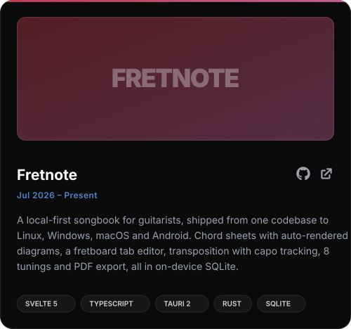
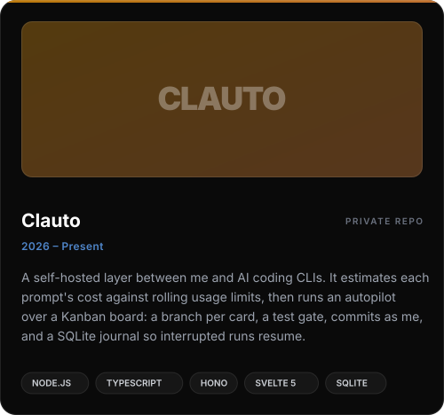
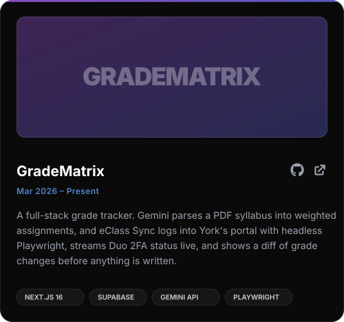
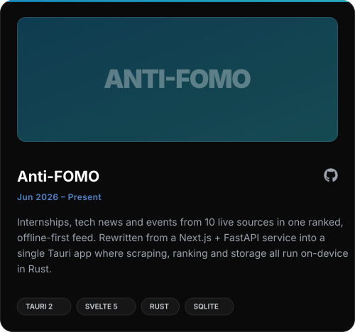
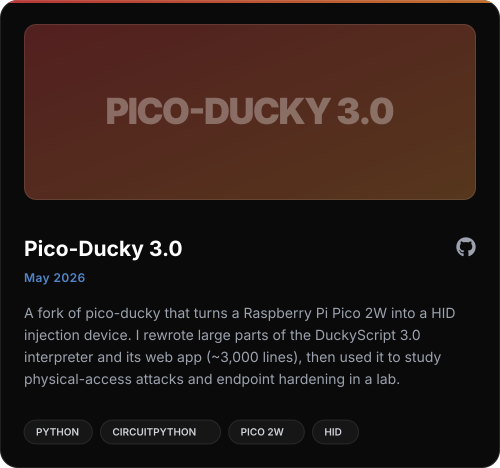
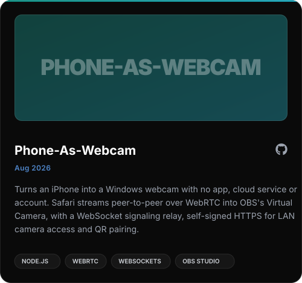

  

I'm a **Software Engineering** student at **York University** (Lassonde), in the **Software Security** stream, and right now I'm an **Application Support Associate Intern at HomeEquity Bank**, fixing defects and shipping features in C#/.NET MVC apps and APIs used by customers, staff and partner firms.

Most of my projects start with a problem I ran into myself: a songbook that works without Wi-Fi, a syllabus I shouldn't have to copy out by hand, an internship feed that replaces a dozen tabs. I mostly build **local-first apps** (Tauri, Svelte, Rust, SQLite) and **full-stack web** (Next.js, Supabase), and I'm learning offensive security, mainly penetration testing and HID injection. Outside software I shoot sports photo and video and run brand content for GDG York.

| | |
| :-- | :-- |
| 🔒 **Security by default** | Don't store what you don't need. Anti-FOMO's York login captured a session *after* Duo 2FA on York's own domain, so a raw password never touched my code. |
| 📴 **Local-first** | Data stays in on-device SQLite. No account, no server, and it still works with the network off. |
| 🎯 **Real users first** | Every project here has at least one person relying on it, usually a classmate, a bandmate, or me. |
| 📐 **Ship it properly** | Typed end to end, CI-built releases, and a README that explains the project. |

 

  

<b>The full toolbox</b>

 

| | |
| :-- | :-- |
| **Languages** | TypeScript / JavaScript, Java, Python, Rust, C#, SQL, HTML/CSS, C++ (Arduino), Bash, LaTeX |
| **Frontend** | Next.js (App Router), React 19, Svelte 5, Tailwind CSS 4, Framer Motion, Astro, Recharts, KaTeX |
| **Backend & native** | Tauri 2, ASP.NET MVC / Razor, Entity Framework, FastAPI, Hono, Node.js, Electron, WPF / .NET 8 |
| **Data** | PostgreSQL, Supabase (auth + row-level security), SQLite, SQL Server |
| **Ship it** | Git, GitHub Actions, Azure DevOps (Pipelines, TFVC), Docker, Vercel, Cloudflare Pages / Workers |
| **AI / LLM** | Gemini API for structured extraction, Ollama and local models, Claude Code and Codex CLIs |
| **Security** | Auth and session design (HMAC-signed cookies), row-level access control, input validation, HID injection and DuckyScript, learning pentesting |
| **Hardware** | Raspberry Pi Pico 2W, ESP32, Arduino, Raspberry Pi, sensors, 3D printing, SPICE circuit simulation |
| **Daily driver** | Arch Linux (Wayland + KDE Plasma), VS Code, Visual Studio, Postman, Obsidian, Tailscale |

 

  

<b>Key contributions</b>

 

**Application Support Associate Intern · HomeEquity Bank** · Toronto · Sep 2026 – Present
- Resolve defects and deliver user stories in C#/ASP.NET MVC web apps and a REST API, tracing issues through controllers, validators and Razor views, then demoing fixes to business stakeholders.
- Reworked referral-program eligibility logic, added layered duplicate-contact validation to the customer portal, and extended a shared reporting method without regressions in dependent reports.
- Ship in Azure DevOps sprints (Boards, Pipelines, TFVC) with code review on every change, ramping up from almost no prior C# or SQL.

**Brand & Content Manager · GDG on Campus York University** · May 2026 – Present
- Shot and edited photo and video coverage of the chapter's flagship event at Google's Canadian headquarters, used for promotion and recruitment.
- Design posters, event graphics and recaps, and tune the posting schedule with the exec team using engagement metrics.

**Digital Marketing & Web Lead · ZUIX INC.** · Sep 2024 – Jun 2026 · [zuix.ca](https://zuix.ca)
- Designed, built and shipped the firm's first production website end to end (Next.js 16, React 19, Supabase, Cloudflare Pages) with continuous deployment.
- Built a password-protected admin dashboard with full CRUD, authenticated with HMAC-signed `httpOnly` session cookies and no third-party auth provider.
- Replaced a manual intake process with a validated estimate-request flow, and directed the photo and video content that launched the brand's socials.

**Freelance Photographer & Videographer · F.O.R.M. Basketball Academy** · Nov 2025 – Jan 2026
- Shot and delivered event coverage at the OVO Athletic Centre in fast, high-pressure conditions.

**STEM Instructor · Envision Robotics** · Dec 2024 – Mar 2025 &nbsp;·&nbsp; **Computer Science Tutor · Bayview Secondary School** · Sep 2023 – Jun 2025
- Taught robotics, 3D-printing and coding workshops for groups of up to 20, and ran one-on-one CS tutoring tailored to each student.

 

  

Live: <a href="https://fretnote-eight.vercel.app">Fretnote</a> · <a href="https://grade-calc-nine.vercel.app">GradeMatrix</a>

<b>More projects</b>

 

| Project | What it is | Stack | Links |
| :-- | :-- | :-- | :-- |
| **MG Studio** | My photo and video portfolio | Next.js 16, Framer Motion | [repo](https://github.com/qwzynx/studio) · [live](https://studio.mahanghafarian.com) |
| **Portfolio** | This design, as a website | Next.js 16, Framer Motion | [repo](https://github.com/qwzynx/Portfolio) · [live](https://www.mahanghafarian.com) |
| **Undercut** | AI used-car deal finder for the GTA; I led the front-end team of a 5-person build | Next.js 14, FastAPI, Go, Gemini | [repo](https://github.com/SoroushRF/Undercut) · [live](https://undercut-seven.vercel.app) |
| **ZUIX INC.** | Production site + admin dashboard for a renovation firm | Next.js 16, Supabase, Cloudflare | [live](https://zuix.ca) |
| **Trillium Pastry** | Small-business showcase with Resend order emails | Astro, Cloudflare Functions | [live](https://trilliumpastry.ca) |
| **Course Tutors** | Exam-prep apps for EECS 2200 (circuit simulators) and MATH 1090 (proof drills) | Next.js 16, KaTeX | private |
| **opencode for Journalling** | Local-LLM journalling companion for Obsidian on a 4B model | opencode, Ollama, Bash | private |
| **FOMO** | Terminal news and events digest, Anti-FOMO's predecessor | Python, BeautifulSoup, SQLite | [repo](https://github.com/qwzynx/FOMO) |
| **FocusBox** | Study timer that notices when you pick your phone back up | Java, Arduino | [repo](https://github.com/qwzynx/ENG1102) |
| **ENG 2003 Portfolio** | Technical writing and hardware docs for Lassonde | Vite, GitHub Pages | [live](https://eng2003.mahanghafarian.com) |

 

  

  

  

Open to **internships, collaborations and interesting problems**, especially where security, systems and things people actually use meet.

  

